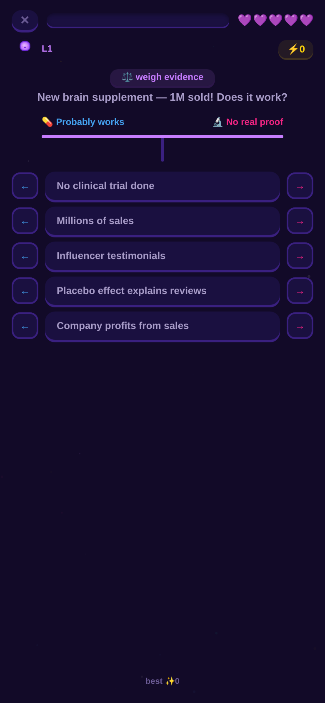
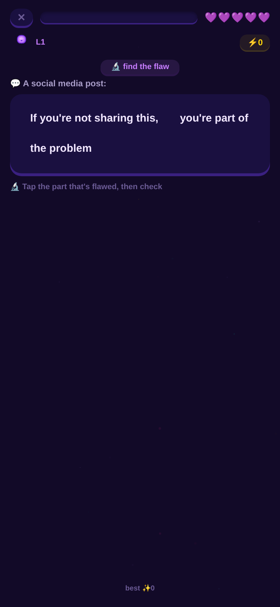
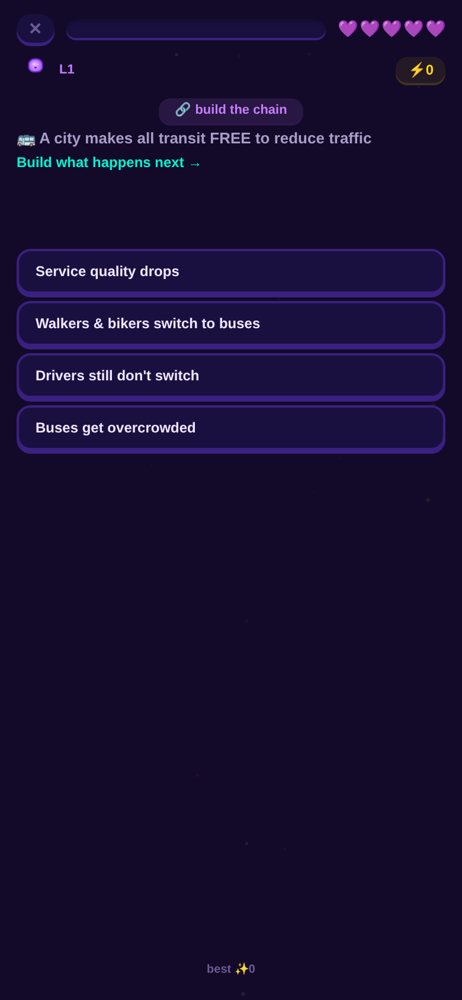
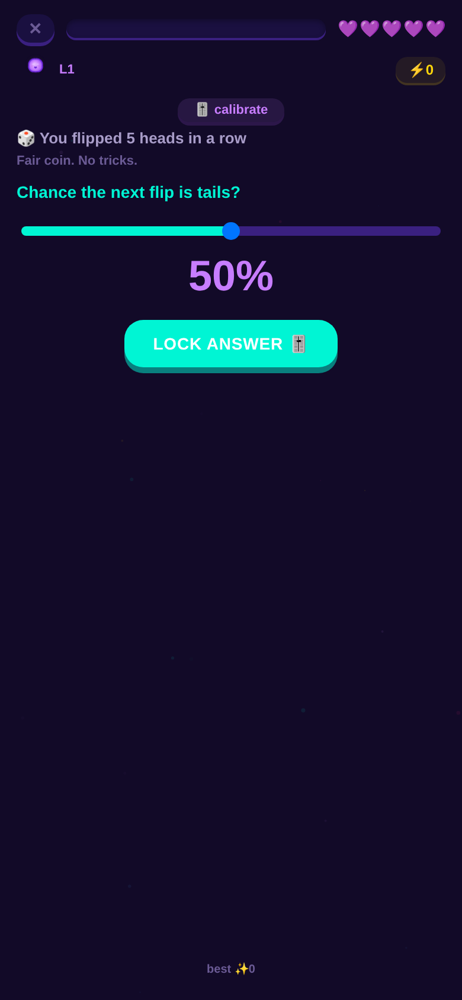
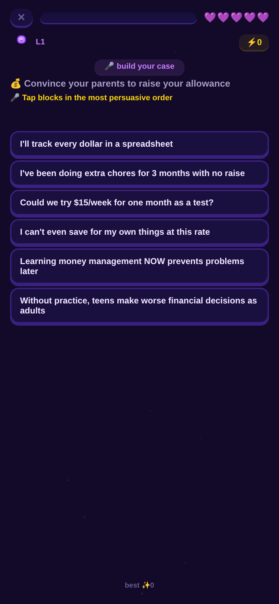
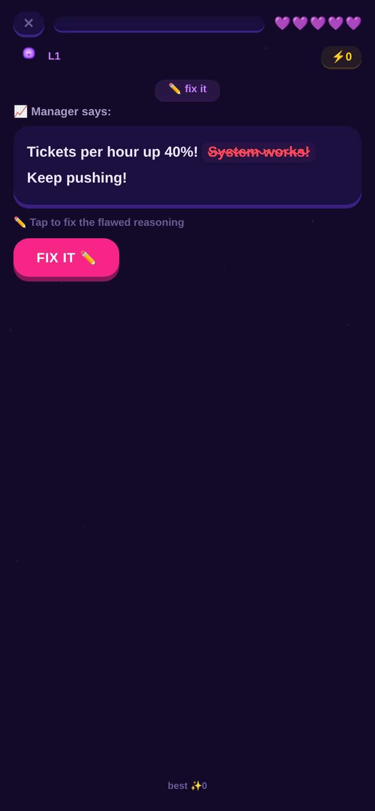
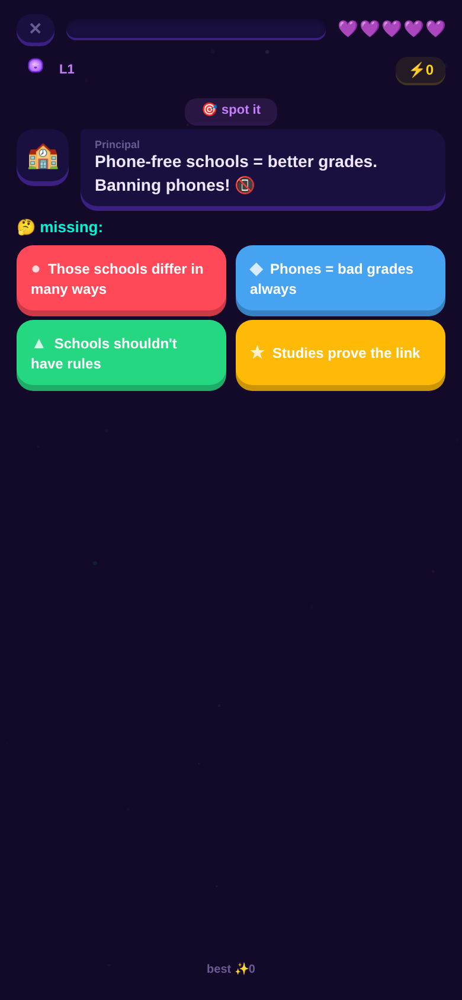
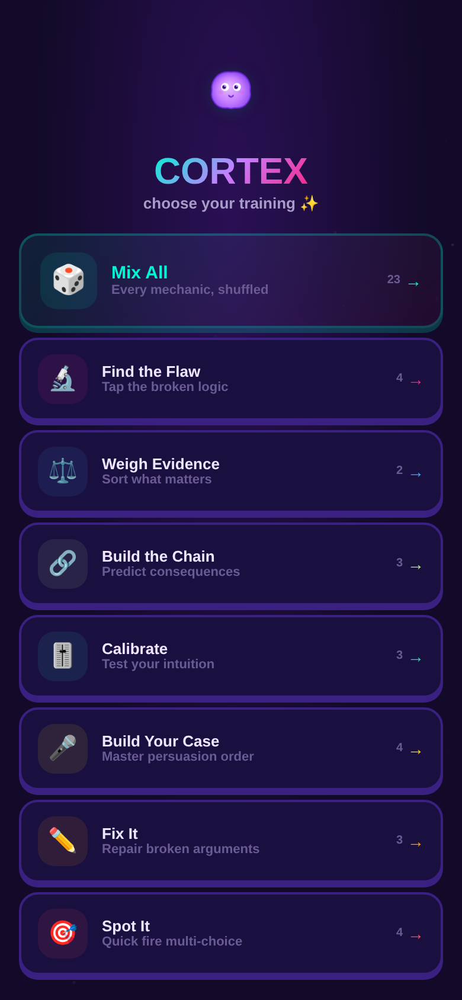

# 🧠 CORTEX

**The reasoning game where the mechanic IS the skill.**

Most "brain training" apps are multiple-choice quizzes with confetti. You either already know the answer or you guess. Guessing isn't learning.

CORTEX is different. You **weigh evidence on a tipping scale**, **build consequence chains**, **calibrate your probability intuition**, and **construct persuasive messages in the right order** — the interaction itself teaches the concept.

---

## 7 Ways to Think

Each mechanic maps directly to a reasoning skill. You don't learn *about* the concept. You **perform** it.

### ⚖️ Weigh Evidence
*Sort evidence cards to tip the scale. Not all evidence is equal.*

<p align="center"></p>

### 🔬 Find the Flaw
*Tap the exact broken phrase. Precision, not guessing.*

<p align="center"></p>

### 🔗 Build the Chain
*Order consequences into a timeline. "Then what? And then what?"*

<p align="center"></p>

### 🎚️ Calibrate
*Set a probability slider, then see reality. Your intuition vs math.*

<p align="center"></p>

### 🎤 Build Your Case
*Arrange argument blocks in persuasive order. Hook → Problem → Stakes → Solution → Evidence → Action.*

<p align="center"></p>

### ✏️ Fix It
*Watch flawed reasoning get rewritten in real-time.*

<p align="center"></p>

### 🎯 Spot It
*Kahoot-style colored answer blocks. Fast pattern recognition.*

<p align="center"></p>

---

## Choose Your Training

<p align="center"></p>

Pick a specific mechanic to practice, or shuffle everything together.

---

## Why This Exists

Every day, teens encounter survivorship bias, false dilemmas, anchoring tricks, and sunk cost traps — and they have zero training to detect them.

The apps that try to help are quizzes. Read a paragraph, pick A/B/C/D. If you don't already know the concept, you're just guessing. The "learning" happens in an explanation you read *after* you already got it wrong.

**CORTEX flips this.** The game mechanic teaches the concept. Sorting evidence on a scale *is* evidence weighing. Building a consequence chain *is* systems thinking. Setting a probability slider *is* calibration. You experience the skill before you're ever told its name.

---

## 23 Concepts Taught

Survivorship Bias · Anecdote ≠ Evidence · Ad Hominem · False Dilemma · Cherry Picking · Correlation ≠ Causation · Confounding Variables · Sunk Cost Fallacy · Confirmation Bias · Anchoring Bias · Availability Heuristic · Bandwagon Effect · Base Rate Neglect · Gambler's Fallacy · Goodhart's Law · Second-Order Effects · Cobra Effect · Perverse Incentives · Appeal to Popularity · Persuasive Structure · Evidence Hierarchy · Audience-First Persuasion · Hook → Stakes → Solution

---

## What We Stole

**From Duolingo** — 3D buttons with bottom shadows, mascot with emotional states and speech bubbles, hearts, progress bar, Nunito font, minimal text.

**From Kahoot** — Each answer is a distinct bold color (red ●, blue ◆, green ▲, yellow ★). The color is the identity.

**From Brilliant** — "Aha moment" reveal with blur-to-sharp animation. Mascot as guide, not decoration.

**What's new** — Nobody combined these into a game where the interaction mechanic and the reasoning skill are the same thing.

---

## Run It

```bash
git clone https://github.com/melmarion/iq.git
cd iq
npm install
npm run dev
```

Open `http://localhost:5173`

### Deploy

```bash
npm run build
```

`dist/` folder is ready for Vercel, Netlify, or any static host.

---

## Stack

React 18 · Vite · Canvas API (animated mascot) · Web Audio API (synthesized sounds, no audio files) · Web Vibration API (haptics on mobile) · CSS animations (confetti, screen shake, combo system)

Zero dependencies beyond React. 900 lines. One file.

---

## What's Next

- [ ] Persistent storage — XP, level, streaks survive across sessions
- [ ] API-generated questions — infinite fresh scenarios
- [ ] Daily challenge with cross-session streaks
- [ ] Spaced repetition — concepts you missed resurface more
- [ ] Social sharing — challenge a friend
- [ ] Drag-and-drop — true drag for chain building and evidence sorting
- [ ] Native iOS — SwiftUI port with Core Haptics

---

<p align="center"><b>CORTEX</b> — think smarter ✨🧠</p>
